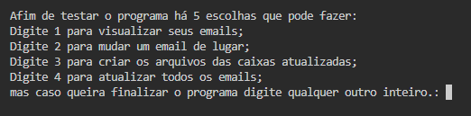
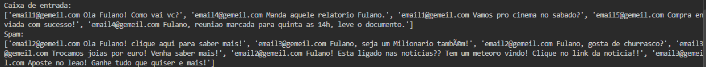
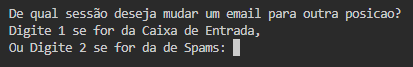
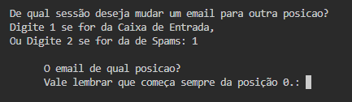
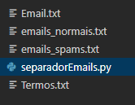

# SeparadorDeEmails

## Introdução
Trabalho final da matéria Inteligência Artificial da turma 2026.1 da Faculdade IBMR.
O objetivo do trabalho foi escrever um código com o básico do Python que pudesse reconhecer e-mails considerados Spam e separa-los de um grupo de e-mails.

### Sobre o Codigo
1) Para ele realizar seu objetivo o programa precisa de dois arquivos de texto:
- Um deles contem os e-mails. (***Email.txt***)
- E no outro os termos para identificar quais seriam os e-mails indesejáveis. (***Termos.txt***)
   
  *Obs.: Eles estão na pasta **Exemplos de Dados**!*

2) Cada e-mail ocupa uma linha do arquivo e é composto primeiro pelo endereço do e-mail e depois separado por espaço o conteúdo do e-mail.
   
   Ex: *email2026.com Mensagem do e-mail.*

3) Para armazenar os *e-mails Spam* e os *Normais* foram utilizadas 2 listas, cada uma representando uma categoria, uma contendo os e-mails considerados suspeitos e outra com os normais.

4) Já para separar os *e-mails Spam* foi criada uma lista para guardar os *endereços suspeitos* ou falsos.
   
   Ex:
   - *ListaSpam = [emailsus1.com, emailsus2.com]*

5) O programa passa por cada e-mail. Primeiro vê se o endereço está na lista entre os *endereços suspeitos*, caso o endereço esteja, o e-mail já é transferido para sua respectiva categoria, que é a lista dos *e-mails Spam*.

6) Já caso o endereço ainda não esteja na lista o programa passa pelo conteúdo do e-mail a procura de algum dos termos do arquivo de termos, caso tenha algum dos termos proibidos ele guarda o endereço de e-mail na lista dos *endereços suspeitos*, se não tiver nenhum dos termos ele vai para a categoria de *e-mails Normais*.

## Funcionamento

### Menu

Ao iniciar o programa usuário tem 5 opções para interagir com o código:
- Visualizar todos os e-mails
- Mudar um e-mail de lugar
- Criar os arquivos das caixas atualizadas
- Atualizar todos os e-mails
- Sair do programa

## Funcionalidades

Funcionalidade para cumprir o requisito do trabalho:
 - Visualizar todos os e-mails existentes, já separados entre Caixa de Entrada e a Caixa de Spam.
   
   *Obs.: Caixa de Entrada = Lista dos E-mails Normais; Caixa de Spam = Lista dos E-mails Spam.*
   
Funcionalidades extras:
- Coloquei a possibilidade do usuário mudar o e-mail para outra categoria (Da Caixa de Entrada para Caixa de Spam ou vice versa).
- Atualizar as duas caixas de e-mails, já que ao mudar os e-mails para outra categoria, os endereços também mudam de estado (Entre *endereço não suspeito* para *suspeito* ou vice versa).
- Criar dois arquivos com os e-mails separados, um com os da Caixa de Entrada, que são os *e-mails normais*, e outro com os da *Caixa de Spam*, os *e-mails spam*.

### Visualização dos E-mails
A inicialmente visualização dos e-mails separados é no terminal, como duas listas já separadas entre *e-mails normais* e *e-mails spam*. Os e-mails seguem a ordem que está no arquivo de e-mails.

### Mudar o E-mail de Lugar
Mudar o e-mail de lugar significa que ele mudará para a outra categoria automaticamente, ou seja, se ele estava na Caixa de Entrada ele mudará para Caixa de Spam e caso ele estava na Caixa de Spam ele mudará para Caixa de Entrada. 

Além disso o endereço também mudará seu estado de *não suspeito* para *suspeito*, ou de *suspeito* para *não suspeito*, assim respectivamente.

Mas naquele momento somente aquele e-mail irá mudar de categoria, os outros e-mails ainda estarão em suas respectivas categorias, ate que o usuário aperte para atualizar todos os e-mails, assim realocando todos os e-mails de *endereços não suspeitos* na Caixa de Entrada e os e-mails de *endereço suspeito* na Caixa de Spam. 

- Primeiro opta em quais das 2 caixas:

 
 
- E depois por qual e-mail dela:
 
 

### Criar os Arquivos das Caixas Atualizadas
Ao selecionar esta opção o programa criará 2 arquivos de texto na mesma pasta chamados ***emails_nomais.txt*** e ***emails_spams.txt***, um com os da Caixa de Entrada, que são os *e-mails normais*, e outro com os da Caixa de Spam, os *e-mails spam*. 

Eles estarão separados da posição em que os e-mails se encontram no momento em que a opção foi selecionada, mas caso o usuário mude os e-mails de categoria, os atualize e selecione esta opção novamente o programa somente irá atualizar os dois arquivos já criados anteriormente. 

*Obs.: Apesar do nome da funcionalidade não fica criando diversos arquivos diferentes.*

## Considerações Finais
Eu achei um bom trabalho para introduzir ao Python de uma forma mais desafiadora, dado o tempo e o conhecimento limitado na época que foi criado acabou que muitas das melhorias que precisariam para aperfeiçoar o projeto acabaram não entrando no projeto finalizado, entre elas:

- Melhorar a visualização dos e-mails para uma visualização mais limpa e ampla, uma opção seria de ao iniciar o programa já haver dois arquivos com já os e-mails separados, de vez de só mostra-los no terminal, assim a visualização ficaria mais "próxima" ao usuário.
- Colocar a opção de adicionar novos e-mails ou excluir e-mails existentes.
- Colocar a opção de adicionar novos termos ou excluir termos existentes.
- Deixar a execução mais eficiente e analisar se no próprio endereço tem informações suspeitas.
- Conseguir analisar e-mails mais complexos ou escrito de outros formatos.
- Melhorar a forma que o programa separa entre e-mails suspeitos ou não.

Ainda daria para melhorar de inúmeras formas além dessas, mas como o objetivo do projeto era para ser uma introdução ao Python, uma complexidade bem maior sairia do objetivo.

## Notas
****Para o programa funcionar o código *separadorEmails.py* e os arquivos *Email.txt* e *Termos.txt*, que estão na pasta Exemplos de Dados, devem estar os 3 na mesma pasta.****

Este projeto foi finalizado em junho de 2026 e na época foi inicialmente publicado para correção com o nome [RastreadoOSpam](https://github.com/Ariproductor/RastreadoOSpam). Este novo repositório é um repositório para oficializar o projeto e dá sua conclusão.

